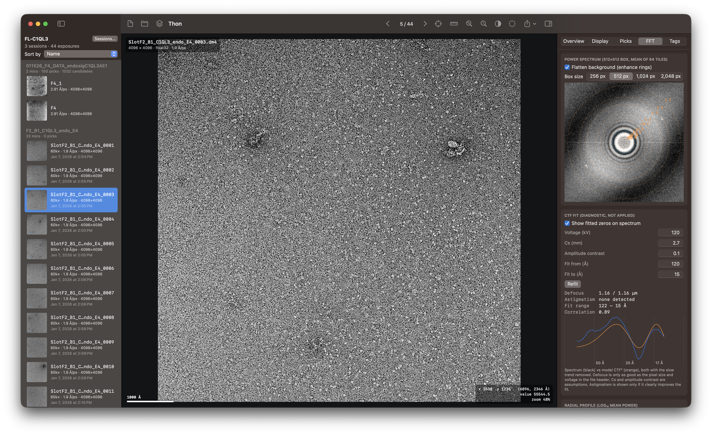
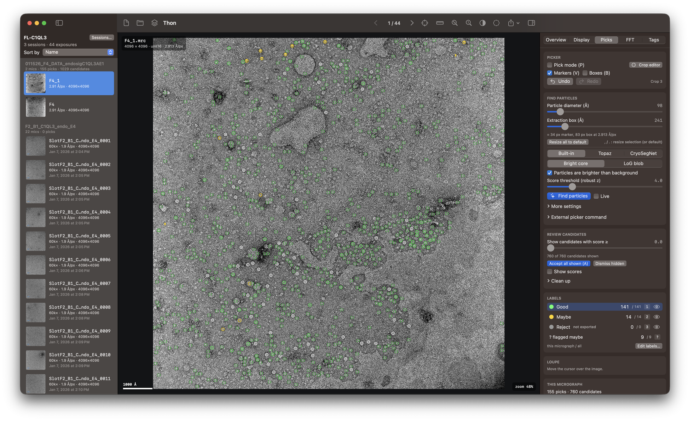
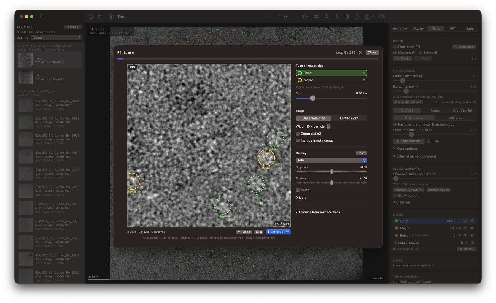

<h1 align="center">Thon</h1>

  <b>A fast, native Mac app for viewing, checking and picking electron micrographs.</b> 
  Open Gatan <code>.dm3</code> / <code>.dm4</code> and <code>.mrc</code> files, check defocus, pick particles, and hand clean picks to RELION.

  
  
  
  

  <a href="#download">Download</a> &middot;
  <a href="#view-and-check">View and check</a> &middot;
  <a href="#pick">Pick</a> &middot;
  <a href="#review">Review</a> &middot;
  <a href="#build-from-source">Build from source</a>

---

## Download

Download the latest DMG straight from [GitHub Releases](https://github.com/sarthaktexas/thon/releases/latest), open it, and drag Thon to your Applications folder. No installer and no account needed.

### Supported devices

| Device | Requirements |
|---|---|
| Mac | Apple silicon (M1 or later), macOS 14 Sonoma or later |
| iPhone (optional, for swiping through picks) | iOS 17 or later, with the Thon Swipe app |
| Any phone with a browser (optional) | Same Wi-Fi network as the Mac, no app needed |

Thon runs on the Mac. The phone options are optional extras for reviewing picks away from the desk.

**Files it reads:** Gatan DM3 and DM4 (`.dm3`, `.dm4`) and MRC (`.mrc`, `.mrcs`). **Particle lists:** RELION `.star` import and export, plus CSV and EMAN export.

## View and check

  

Your exposures are listed on the left, the image is rendered on the GPU in the middle, and everything you can read or change about it is in the inspector on the right. Pan, zoom, adjust contrast, low-pass filter, flatten the background, and measure features with a scale bar that follows the file's own calibration. Pixel size, voltage, magnification and the rest of the acquisition metadata are read straight from the file.

**Is this micrograph any good?** The FFT tab shows the tile-averaged power spectrum with resolution rings in Ångströms. Turn on *Flatten background* and the Thon rings stand out. A CTF fit estimates defocus (and astigmatism, when it clearly improves the fit) and draws the fitted zeros on the spectrum so you can see whether they follow the rings. The fit is a diagnostic: nothing in your data is ever corrected.

## Pick

  

Set the particle diameter, press **Find particles**, and candidates appear on the micrograph. The built-in auto-picker needs no setup. Topaz and CryoSegNet can be switched on in Settings (⌘,) as optional engines that run in a Python environment you provide. Drag the score threshold to decide how many candidates to show, accept everything above it in one key press, and label picks as good, maybe or reject (or define your own labels). Work from a single micrograph or across a whole folder.

When you are done, export to RELION `.star`, CSV or EMAN. Rejected picks are left out.

## Review

  

The crop editor takes you through your picks one zoomed-in crop at a time, so every decision is made at a size where you can actually see the particle. Move or resize a circle, add one, or double-click to remove it. Mark each circle green (sure) or yellow (maybe). Thon learns from your edits as you go and shows the crops it is least sure about first, so your effort goes where it matters most.

Prefer the couch? You can also swipe through candidates from your phone, in a browser on the same network or with the Thon Swipe iPhone app, which connects over Bluetooth or direct Wi-Fi with no router needed.

## Organize

Group folders into `.thon` projects with one session per grid, so picks, labels and decisions stay together and survive renaming or moving a folder. Projects are backed up automatically. Import a RELION classification to color every pick by class and remove whole bad classes at once.

## Build from source

Most people should use the [download](#download). To build it yourself, you need macOS 14+ and Xcode 15+ (command-line tools are enough). There are no third-party Swift dependencies; Python is needed only for the optional Topaz and CryoSegNet engines.

    ./build_app.sh                 # builds Thon.app next to this file
    open Thon.app                  # or: open Thon.app --args /path/to/folder-or-file

Run `.build/release/Thon --selftest` once on a new machine to check the Metal shaders against CPU reference code.

## Name

Thon rings are the oscillating rings in a micrograph's power spectrum that you read defocus from.

## License

MIT, see [LICENSE](LICENSE). Not affiliated with or endorsed by Gatan, cryoSPARC or RELION; those names only describe file formats and workflows.
