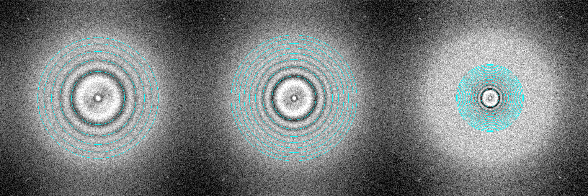

# Thon

Native macOS micrograph viewer for Gatan DigitalMicrograph `.dm3` / `.dm4` files and `.mrc` / `.mrcs` micrographs, laid out like the cryoSPARC
exposure viewer: exposure list on the left, GPU-rendered image in the center, inspector on the right. Includes a particle picker
(auto-pick, manual editing, gallery, swipe mode, RELION class back-mapping): see [docs/PICKER_GUIDE.md](docs/PICKER_GUIDE.md).

* Swift 5 / SwiftUI shell, Metal (MetalKit) renderer, Accelerate (vDSP) FFT, Swift Charts. No third-party dependencies.
* Requires macOS 14+ and Xcode 15+ (command-line tools are enough for `swift build`).

*FFT tab, CTF diagnostic: fitted zeros (cyan) over the power spectra of three micrographs at different magnifications. The fit is for inspection only; nothing is corrected.*

## Build and run

    ./build_app.sh              # builds Thon.app next to this file (ad-hoc signed)
    ./build_app.sh --install    # ...and copies it to /Applications
    open Thon.app --args "/path/to/folder/or/file.dm4"

or `swift run -c release Thon /path/to/folder`.

## First thing to run on a new machine

The Metal shaders are compiled at launch from source embedded in `Shaders.swift`. Verify them and the GPU filters
against CPU reference implementations once:

    .build/release/Thon --selftest

It prints PASS/FAIL per check (shader compile, Gaussian low-pass, background flatten, nearest/bilinear/pyramid
rendering, invert) and exits non-zero on failure. It then runs the CPU logic tests of the picker (same as `--picktest`).

    .build/release/Thon --picktest [--data /path/to/relion-project]    # headless: MRC, picks, auto-picker, import/export, gallery, swipe

`--data` additionally checks the importer and the RELION class back-mapping against the star files and micrographs of a real RELION project.

## Command-line helpers (headless)

    Thon --dump FILE.dm4 [--tags] [--fft]                 # metadata summary, stats, optional full tag list / FFT profile
    Thon --autopick FILE.mrc [--diameter nm] [--z 4] [--method core|log] [--dark] [--flatten nm] [--max n]   # prints x,y,score CSV
    Thon --export-picks PROJECT_DIR OUT_DIR [--eman] [--no-csv] [--done]                                    # export picks_project.json without the GUI
    Thon --render FILE.dm4 OUT.png [--lowpass S] [--flatten S] [--size WxH] [--invert]   # offscreen Metal render

## What it shows

* Exposure list (recursive folder scan, drag-and-drop): embedded GMS thumbnail, indicated magnification, pixel size, dimensions, acquisition time; sort by name / time / magnification.
* Image: pan (drag), zoom at cursor (wheel / pinch), double-click or `F` to fit, `1` for 100 %, `I` invert, ←/→ previous/next. Scale bar from the calibration, cursor position (px and nm) and raw pixel value.
* Display: auto contrast (percentile or mean ± nσ) or manual black/white points, gamma, invert; GPU Gaussian low-pass and large-scale background flattening.
* Overview tab: histogram with the contrast window, plus File / Image / Acquisition / Microscope / Session sections pulled from the DM tags (pixel size, FOV, mean signal in e⁻/Ų when the intensity calibration is in electrons, camera, exposure, binning, drift, voltage, magnification, stage, …).
* FFT tab: power spectrum of the center crop (power of two, Hann window) with resolution rings in Å, optional division by the radial mean to make Thon rings visible, and radial profile.
* Tags tab: every tag in the file, filterable.
* Export: PNG (current contrast), MRC float32 raw or filtered (rows flipped to MRC bottom-left origin; pixel size written to the cell). Note: the picker reads MRC files as stored (row 0 on top, like RELION / mrcfile), so an MRC exported from here appears upside down relative to the DM view if you open it again.

## Notes

* Pixel size is read from the image Calibrations (nm, µm, Å) of the largest non-RGB image in the file; the 384×384 RGB entry is the GMS thumbnail.
* MRC modes 0, 1, 2, 6 and 12 (either byte order, extended header skipped) are read; pixel size comes from cell / grid size (a cell equal to the grid, i.e. 1.0 Å/px, is treated as uncalibrated).
* DM3 (32-bit lengths) and DM4 (64-bit lengths), little- and big-endian, int/uint 8–32, float32/64 and complex (magnitude) pixel types are handled; stacks show frame 0 with a frame stepper.
* No CTF correction is applied anywhere.
* The Apple Neural Engine is not used. It can only be reached through Core ML, and nothing in this viewer is a neural network. Rendering and filtering run on the GPU through Metal; the FFT runs through Accelerate.

## Name

Thon is named after Thon rings, the oscillating rings in the power spectrum of a micrograph that you read off the FFT tab to judge defocus and astigmatism.

## License

MIT, see [LICENSE](LICENSE). Thon is an independent project and is not affiliated with or endorsed by Gatan, the cryoSPARC authors or the RELION authors; those names are used only to describe the file formats and workflows it reads and writes.
